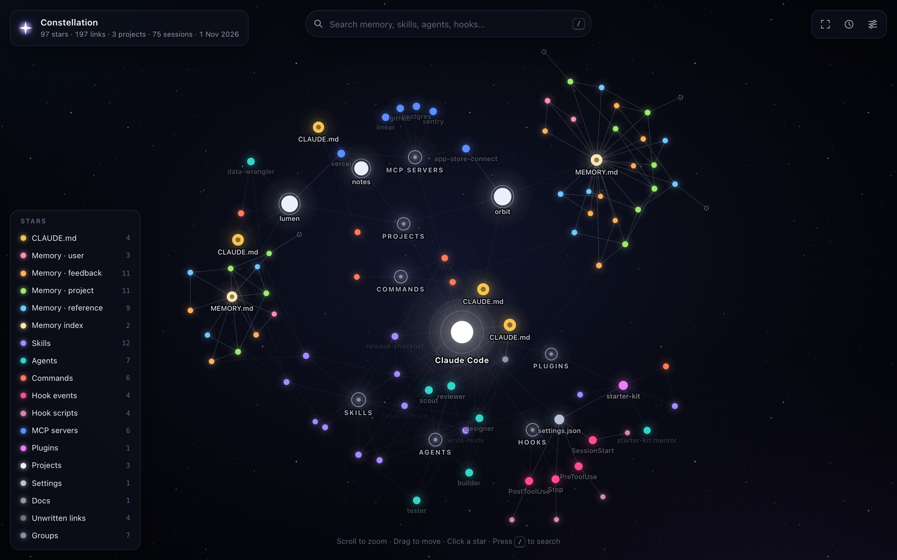
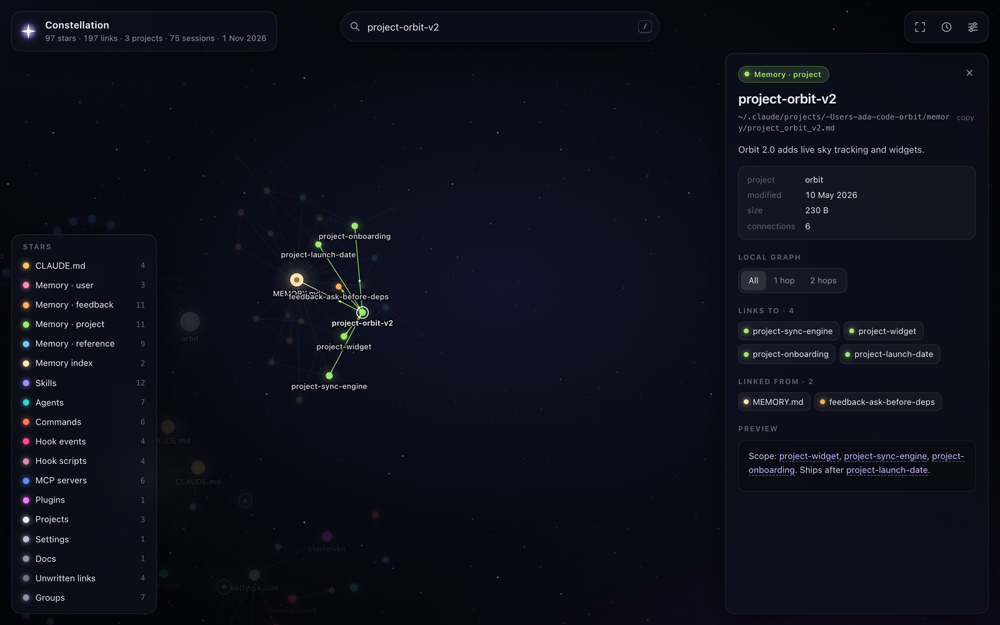

# Constellation

See your Claude Code context as a star map.

Constellation reads your `~/.claude` folder. It draws every memory note, skill, agent, command, hook, MCP server, plugin and project as a star. It draws the links between them as lines, like the graph view in Obsidian.



## Run it

You need Node.js 18 or later. There is nothing to install.

```sh
npx github:EyeDipInBytes/claude-constellation --open
```

This writes `constellation.html` in the current folder and opens it in your browser.

To work on the code:

```sh
git clone https://github.com/EyeDipInBytes/claude-constellation
cd claude-constellation
node bin/constellation.js --open
```

## What you see

| Star | Source |
| --- | --- |
| CLAUDE.md | `~/.claude/CLAUDE.md` and the CLAUDE.md of each project |
| Memory | Notes in `~/.claude/projects/*/memory/`, colored by type: user, feedback, project, reference |
| Memory index | `MEMORY.md` in each memory folder |
| Skills | `~/.claude/skills/*/SKILL.md`, project skills and plugin skills |
| Agents | `~/.claude/agents/*.md`, project agents and plugin agents |
| Commands | `~/.claude/commands/*.md`, project commands and plugin commands |
| Hook events and scripts | The `hooks` block of each `settings.json`, linked to the script each hook runs |
| MCP servers | `~/.claude.json`, project `.mcp.json` files and plugins |
| Plugins | `~/.claude/plugins/installed_plugins.json` |
| Projects | `~/.claude/projects/`, sized by the number of sessions |
| Docs | Markdown files outside `~/.claude` that your notes link to |
| Unwritten links | A `[[link]]` to a note that does not exist yet |

The lines come from four sources:

- **Links.** `[[wikilinks]]` and `[markdown](links.md)` between files.
- **Mentions.** A file names a skill, agent, command, MCP server or plugin, for example `/release-checklist` or `` `reviewer` ``.
- **Uses.** A settings file runs a hook, a hook runs a script, a project uses an MCP server.
- **Structure.** A project holds its notes, a plugin holds its skills. These lines are faint.

## How to use the map

- Scroll to zoom. Drag the sky to move. Drag a star to pull it.
- Hover a star to light up its neighbors. Small dots flow along each line.
- Click a star to open its panel: path, description, settings, links and a text preview.
- Click **1 hop** or **2 hops** in the panel to see only the local graph.
- Press `/` to search. Press `Enter` to fly to the first match.
- Click a row in the legend to hide that kind of star. Alt-click to show only that kind.
- Press `T` for the time-lapse. Stars appear in the order you made the files.
- Press `F` to fit the map to the screen.
- Open the settings button to change the forces: repel, link distance, link strength and center pull.



## Options

```text
--out <file>      Where to write the page (default: ./constellation.html)
--open            Open the page in your browser when done
--home <dir>      Read <dir>/.claude and <dir>/.claude.json (default: your home)
--json <file>     Also write the raw graph as JSON
--redact          Leave out previews, descriptions and settings (names stay)
--anonymize       Also replace names and paths with numbers (implies --redact)
--all-projects    Include projects that live in temp folders
--no-docs         Do not add markdown files that your notes link to
```

## Privacy

- The page holds text from your notes and skills. Keep it on your machine.
- Share a page only after `--redact` or `--anonymize`.
- The page makes no network requests. A Content Security Policy with `default-src 'none'` blocks them.
- The scanner never reads the values in an `env` block. It never reads MCP arguments, headers or URLs with paths. It reads only the name, the transport and the host of each server.
- Every text preview passes through a secret filter. The filter removes API keys, tokens, JWTs, private keys and `password=` pairs.
- Paths show `~` in place of your home folder.

## The demo

`examples/make-demo.js` builds a fictional Claude Code home for "Ada", an indie developer with three projects. Run it to see the map without your own data:

```sh
npm run demo        # writes docs/demo.html
npm test            # runs the tests on the demo home
```

## How it works

- `src/scan.js` reads the files and builds a list of nodes and links. It has no dependencies.
- `src/render.js` puts the graph, the CSS and the JavaScript into one HTML file.
- `src/viewer/` draws the map on a canvas. It runs its own force simulation with a Barnes-Hut quadtree, so it needs no libraries.

## License

MIT
